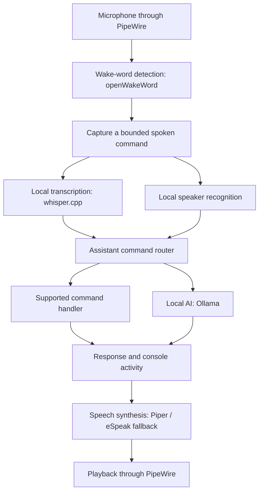

# Jarvis

Jarvis is a local voice and vision assistant built for an Ubuntu computer. It combines
wake-word detection, speech recognition, local AI responses, speaker recognition,
a terminal mission-control interface, music controls, and optional camera tools.

The project brings these systems together into one assistant: a spoken command can
move from the microphone to a local transcription service, through a command router,
and back as a spoken response with visible activity in the console.

The reference installation is an **Intel Mac mini running Ubuntu 24.04**. This
repository contains the source, launchers, service templates, tests, and recovery
documentation. Models, personal recordings, and machine-specific configuration
are provisioned separately.

## Explore the project

- [Features](#features)
- [How a voice command works](#how-a-voice-command-works)
- [Getting started](#getting-started)
- [Using Jarvis](#using-jarvis)
- [Source layout](#source-layout)
- [Configuration and services](#configuration-and-services)
- [Private data and local processing](#private-data-and-local-processing)
- [Development and verification](#development-and-verification)
- [Documentation](#documentation)
- [Licensing](#licensing)

## Features

| Area | What Jarvis does | Main components |
| --- | --- | --- |
| Voice interaction | Detects a wake phrase, captures a bounded command, transcribes speech, and speaks responses. The wake configuration supports one command per wake phrase. | openWakeWord, whisper.cpp, PipeWire, Piper with eSpeak fallback |
| Command routing and AI | Handles supported commands through dedicated routes and uses a local language model for AI responses. | Assistant package, Ollama |
| Speaker recognition | Uses locally enrolled voice profiles to identify speakers. Profiles and enrollment recordings remain private. | Speaker module, Titanet model |
| Mission-control console | Displays assistant activity, microphone levels, responses, music information, and system telemetry. | Terminal UI, reactor renderer, status and vitals modules |
| Computer awareness | Answers bounded questions about local storage, memory, load, and service state through read-only inspection tools. | Computer inspection module and local AI planner |
| Local music | Controls a private MPV player and temporarily lowers its volume during commands, with recovery afterward. Spotify is a separate optional integration. | Music controller, ducking module, MPV IPC |
| Daily mission briefing | Reads a manually prepared local class plan and displays its mission, tasks, assignments, and success condition. | Briefing command and console panels |
| Camera and recording | Provides a shared camera feed, photo capture, previews, and requested Captain's Log recordings. | Camera feed, recording package, FFmpeg |
| Optional vision | Processes captured photos with SAM3; includes separate object-monitoring, depth-estimation, measurement, and gesture components. | SAM3, Depth Anything 3, MediaPipe |
| Terminal animation | Plays **Iron Man: Skyfall**, a 54-second 3D ASCII film with timed camera shots and optional locally supplied music. | Python renderer and separate MPV score player |

Camera, depth, gesture, Spotify, and animation features have their own setup needs.
Their presence in the source does not mean every component runs by default.
See the [setup guide](docs/SETUP.md) for environment and hardware requirements.

## How a voice command works



The voice path coordinates listening, cancellation, console state, and music ducking.
Camera processing and recording are separate paths: the SAM3 watcher processes
completed JPEG captures, while Captain's Log recording uses the shared camera feed
and an audio source.

For module-level details, see [Architecture](docs/ARCHITECTURE.md).

## Getting started

### 1. Choose a setup path

**To inspect the code or run automated checks:** use the development steps below.
The checks use temporary state and synthetic media; model downloads, a microphone,
a camera, and personal recordings are not required.

**To run the assistant:** follow [Setup and recovery](docs/SETUP.md). A complete
voice installation needs audio hardware, separate Python environments, local model
files, whisper.cpp, Ollama, and selected user services. Optional vision components
have additional environments and dependencies.

### 2. Clone the source

Use `$HOME/Jarvis` for the checkout. Several modules assume this location even
when individual launchers accept `JARVIS_HOME`.

```bash
git clone https://github.com/Arnav210/Jarvis.git "$HOME/Jarvis"
cd "$HOME/Jarvis"
```

If you already have a Jarvis checkout, use that checkout rather than cloning over it.

### 3. Run the source checks on Ubuntu

With Git and Python 3.12 installed:

```bash
sudo apt-get install python3.12-venv mpv
python3.12 -m venv .venv-test
.venv-test/bin/python -m pip install -r requirements/test.txt
.venv-test/bin/python tools/check_repository.py --history
.venv-test/bin/python tools/run_checks.py
```

MPV is used by silent integration checks with null audio output and temporary
sockets. These commands validate source behavior; they do not install services
or start the assistant's microphone or camera.

### 4. Prepare runtime dependencies separately

The full setup guide covers:

- System packages and the expected command shortcuts under `~/.local/bin/`.
- Separate wake-word, speaker-recognition, and text-to-speech environments.
- whisper.cpp builds, transcription models, Piper voices, and speaker models.
- Ollama and its configured local models.
- Optional SAM3, depth, gesture, and Spotify setup.
- Hardware selection, environment settings, and user-service installation.

Observed environment snapshots are recovery references, not a universal installer
or a cross-platform lockfile. Model origins, paths, and recorded checksums are in
[MODELS.json](docs/MODELS.json); upstream revisions and dependencies are in
[DEPENDENCIES.json](docs/DEPENDENCIES.json).

## Using Jarvis

Once the relevant components are configured, say **Hey Jarvis** before each new
voice command. Examples documented by the project include:

| Request | Behavior |
| --- | --- |
| "Mission briefing" | Reads the local class plan and keeps it visible in the console. |
| "How much free disk space do we have?" | Reports storage information through bounded inspection tools. |
| "How much memory is available?" | Reports available memory. |
| "Is the jarvis-wake service running?" | Inspects service state without restarting the service. |
| "Which folders inside Jarvis take up the most space?" | Performs a bounded folder-size scan and labels partial results. |
| "Play the Iron Man animation" | Opens the ASCII film and plays its score if a local audio file is available. |

Computer inspection is limited to the user's home directory for filesystem
questions and reads file names and metadata, not file contents. It exposes no
arbitrary shell-command, file-editing, installation, or deletion tool.
See [Computer awareness](docs/COMPUTER_AWARENESS.md) for its limits and examples.

### Terminal entry points

Launchers live in `bin/`. These examples use their checkout paths so they also
work before command shortcuts are installed:

```bash
# Open the desktop mission-control view.
"$HOME/Jarvis/bin/jarvis-status" --open

# Print a computer-inspection answer without speech.
"$HOME/Jarvis/bin/jarvis-computer" "How much free disk space do we have?"

# Validate and preview the private mission briefing without speech.
"$HOME/Jarvis/bin/jarvis-briefing" --preview

# Render one animation frame without playback or opening a viewer.
"$HOME/Jarvis/bin/jarvis-ironman" --frame 31 --width 144 --height 48
```

The briefing is stored locally at `data/mission-briefing.txt` and is triggered
manually. See [Daily mission briefing](docs/MISSION_BRIEFING.md) for its format.
The animation's optional music is excluded from Git; see
[Iron Man: Skyfall](docs/IRON_MAN.md) for controls and audio setup.

Other launchers include `jarvis-listen`, `jarvis-speak`, `jarvis-music`,
`jarvis-camera`, `jarvis-preview`, `jarvis-log`, `jarvis-enroll`,
`jarvis-identify`, `jarvis-vitals`, and `jarvis-reset`. Commands that listen,
speak, capture, record, enroll, or play media act on the configured hardware and
local state.

## Source layout

| Location | Purpose |
| --- | --- |
| `bin/` | User command launchers and the SAM3 watcher wrapper. |
| `src/jarvis/assistant/` | Command routing, local AI integration, activity state, and mission briefings. |
| `src/jarvis/audio/` | Wake detection, listening coordination, speaker recognition, and microphone levels. |
| `src/jarvis/computer/` | Bounded computer inspection and reset coordination. |
| `src/jarvis/music/` | Local music control, volume ducking, and optional Spotify integration. |
| `src/jarvis/recording/` | Captain's Log recording. |
| `src/jarvis/ui/` | Console layout, reactor and animation renderers, status, and telemetry. |
| `src/jarvis/vision/` | Camera feed, previews, SAM3 processing, object monitoring, depth, and gestures. |
| `systemd/user/` | User-service templates and wake-service overrides. |
| `tests/` | Unit tests, silent integration checks, and synthetic fixtures. |
| `tools/` | Repository/history audit, layout validation, and regression runner. |
| `requirements/` | Test requirements and observed runtime environment snapshots. |
| `config/` | Example settings and tracked configuration templates. |
| `patches/` | Preserved third-party SAM3 compatibility edits and upstream notice. |
| `docs/` | Setup, architecture, operations, feature guides, and dependency inventories. |

See [Reorganization notes](docs/REORGANIZATION.md) for compatibility entry points
and migration details.

## Configuration and services

[config/jarvis.env.example](config/jarvis.env.example) documents common settings.
Jarvis does **not** automatically load an `.env` file. Export settings for shell
commands, or configure a private environment file through a systemd drop-in.

The example configuration uses PipeWire for microphone input, a local transcription
endpoint at `127.0.0.1:8178`, and Ollama at `127.0.0.1:11434`.
Machine-specific microphone selections, credentials, and overrides remain local.

Repository service templates are under `systemd/user/`; installed user units
live under `~/.config/systemd/user/`. Templates are reviewed and installed
separately. They cover wake listening, transcription, camera feed, SAM3 watching,
recording, music, Spotify, and streaming.

Useful read-only checks on an installed system:

```bash
systemctl --user is-active jarvis-wake.service
systemctl --user status jarvis-stt.service --no-pager
journalctl --user -u jarvis-wake.service -n 50 --no-pager
```

Start only the components you intend to use after following the setup guide.
The optional remote stream uses the existing private network; changing repository
templates does not automatically update or restart installed services.

## Private data and local processing

The core voice path uses local transcription, inference, and speech synthesis.
Dependency downloads, model provisioning, and optional online integrations such
as Spotify have separate network requirements.

Git tracks source and documentation. The following remain excluded:

| Local location or category | Contents |
| --- | --- |
| `data/` | Captain's Logs, mission briefings, conversation state, music, and other generated data. |
| `Footage/` | Camera captures. |
| `Masks/` | Segmentation outputs and run results. |
| `VoiceProfiles/` | Enrolled speaker profiles and related private data. |
| `models/`, `voices/` | Separately provisioned model weights and speech assets. |
| Environments, caches, credentials, and runtime state | Machine-specific dependencies, tokens, and generated working state. |

`Footage/` and `Masks/` remain separate top-level directories. Third-party
checkouts such as `sam3/`, `whisper.cpp/`, and `Depth-Anything-3/` are
also provisioned separately.

The repository uses an explicit source allowlist: new source files or categories
must be included deliberately. Ignoring a file does not remove it from existing
Git history. Back up irreplaceable recordings and profiles separately; a source
checkout cannot restore them. See [Repository policy](docs/REPOSITORY.md).

## Development and verification

Work on a branch, review changes, and stage explicit file paths:

```bash
git status --short
git diff
git add <reviewed-source-path>
git diff --cached
```

Before publication, run the repository/history audit and regression runner from a
prepared environment:

```bash
.venv-test/bin/python tools/check_repository.py --history
.venv-test/bin/python tools/run_checks.py
```

The checks cover unit behavior, console layouts, and silent music integration,
including volume ducking and recovery. They use temporary state and synthetic
media rather than personal recordings or a live music library.

Passing checks does not verify room audibility, wake-word accuracy, camera capture,
or full optional-model inference on a new machine. Hardware behavior needs its own
explicit verification. The [readiness report](docs/READINESS.md) records preparation
checks and their limits.

Keep commit author information linked to your own GitHub account so contributions
are traceable. After a deployed code change, restart only affected services and
verify the relevant behavior. Documentation changes do not require service restarts.
Use `git revert` for a committed rollback.

## Documentation

| Guide | What it covers |
| --- | --- |
| [Setup and recovery](docs/SETUP.md) | Dependencies, environments, models, hardware configuration, and service installation. |
| [Architecture](docs/ARCHITECTURE.md) | Component relationships, data flow, and module mapping. |
| [Operations](docs/OPERATIONS.md) | Silent inspection, logs, maintenance, and source validation. |
| [Computer awareness](docs/COMPUTER_AWARENESS.md) | Inspection tools, boundaries, and voice/terminal examples. |
| [Daily mission briefing](docs/MISSION_BRIEFING.md) | Local briefing format, preview, and console behavior. |
| [Iron Man: Skyfall](docs/IRON_MAN.md) | Film controls, choreography, timing, and private audio setup. |
| [Repository policy](docs/REPOSITORY.md) | Tracked source, excluded private data, and publication review. |
| [Readiness report](docs/READINESS.md) | Recorded verification and remaining setup limits. |
| [Reorganization notes](docs/REORGANIZATION.md) | Source migration, compatibility, and recovery details. |
| [Model inventory](docs/MODELS.json) | Model files, sources, paths, and recorded checksums. |
| [Dependency inventory](docs/DEPENDENCIES.json) | Upstream projects and observed revisions. |

## Licensing

No open-source license has been selected for first-party code. This public
repository shares the Jarvis source for inspection; no additional reuse license
is granted. Third-party code, model weights, and media retain their own terms.
The SAM3 compatibility patch and its upstream notice are preserved in `patches/`.
